<div align="center">

# ❤️ CardioClarity Studio

### Your heart tests, explained simply.
**See which artery is at risk, the main reasons why, and what to do next, on an interactive 3D heart, with a spoken summary in English or Hindi.**

<table align="center">
<tr>
<td align="center" width="33%">

### 🎬 Watch the demo

<a href="https://youtu.be/oskivSGjGLw"></a>

<sub>The whole app in a few minutes<br>Narrated walkthrough</sub>

</td>
<td align="center" width="33%">

### 🚀 Try it live

<a href="https://cardioclarity-962866578386.us-central1.run.app"></a>

<sub>cardioclarity-962866578386.us-central1.run.app<br>No sign-in · works in any browser</sub>

</td>
<td align="center" width="33%">

### 📄 Read the documentation

<a href="docs/submission/DOCUMENTATION.pdf"></a>

<sub>6-page PDF, organised by the Track A criteria<br><a href="docs/submission/DOCUMENTATION.html">HTML version</a></sub>

</td>
</tr>
</table>

[](https://multimodal-ai-hackathon-2026-7.devpost.com/)


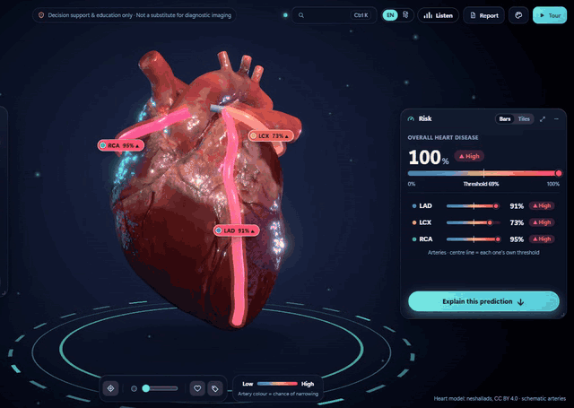

<sub>Live recording: patient 174 · rotate the heart · click an artery and the camera flies to it · peel the heart to X-ray</sub>

### 🎬 Demo video

<a href="https://youtu.be/oskivSGjGLw"></a>

<sub>Click to watch on YouTube</sub>

</div>

> [!IMPORTANT]
> For decision support and education only. Not a substitute for diagnostic imaging or clinical judgement.

---

## 🩺 The problem

<p align="center">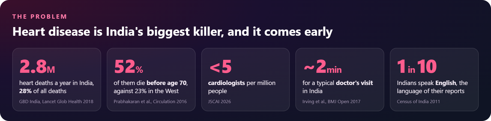</p>

Heart disease causes **more than one in four deaths in India**. It strikes about **ten years earlier** than in the West, so the people it takes are often parents and earners in their working years.

Most of them have already had the tests that could have warned them. A blood test, an ECG, an echo. But this is what they walk out with:

<p align="center">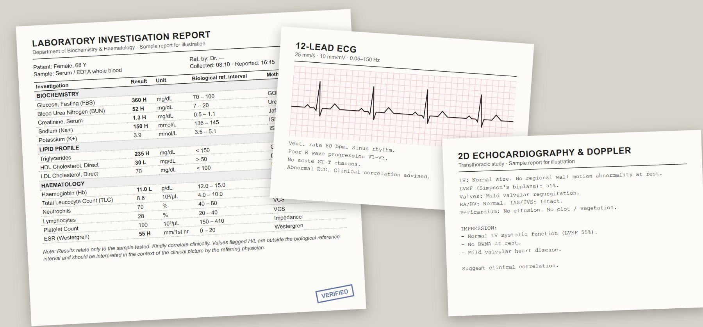</p>
<p align="center"><sub>Illustration we made from the real test values of study patient 174. Every report ends the same way: <i>"clinical correlation advised"</i>.</sub></p>

**Three pages of English** that only one Indian in ten can read. Flags like `H` and `L`, abbreviations like `RWMA` and `LVEF`, and not a single word on what it means for *her* heart. Her doctor has **about two minutes** to make sense of it, and the software they use looks like this:

<p align="center">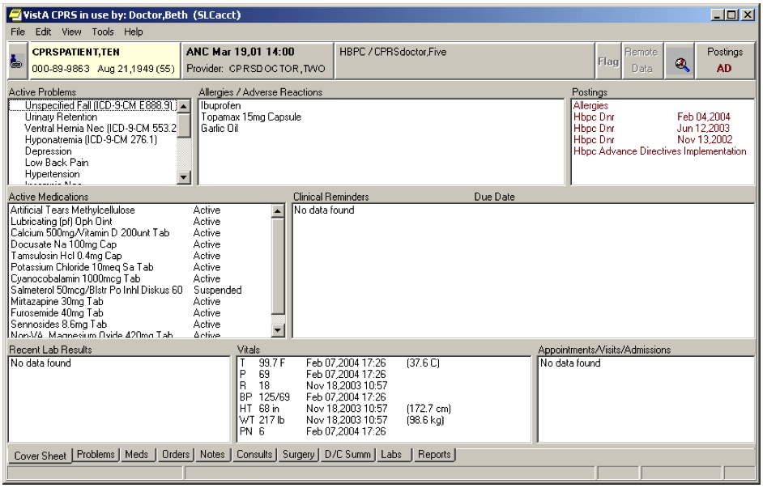</p>
<p align="center"><sub>A typical electronic health record: VistA CPRS, the US Veterans Affairs system, with test data. Public domain (US government work, via <a href="https://commons.wikimedia.org/wiki/File:VistACPRScover.png">Wikimedia Commons</a>). Everything is there, nothing is explained.</sub></p>

Risk calculators help a little, but they give **one number**. None of them answers the four questions every patient actually has:

| | The question | What they get today |
|:-:|---|---|
| 📍 | **Where** is the problem? | Nothing. One risk number for the whole heart |
| ❓ | **Why** me? | Nothing. A list of `H` and `L` flags |
| 👣 | **What do I do next?** | "Clinical correlation advised" |
| 🗣️ | **Can you tell me in my language?** | English only |

---

## 💡 Our answer

CardioClarity Studio takes the tests a patient **already has** (history, examination, ECG, blood tests, echo: 49 values in total) and turns them into one screen a doctor can read at a glance and a patient can understand.

| The question | CardioClarity's answer |
|---|---|
| 📍 **Where?** | The risk of coronary artery disease (CAD) **and of each of the three main arteries** (LAD, LCX, RCA), drawn on a 3D heart |
| ❓ **Why?** | Every test result's push up or down, in plain percentage points, with SHAP |
| 👣 **What next?** | A plain-language report with questions to ask and when to get help straight away, plus what-if sliders for the changes a patient can make |
| 🗣️ **In my language?** | A spoken summary in English or **Hindi**, voiced by Sarvam AI |

<p align="center">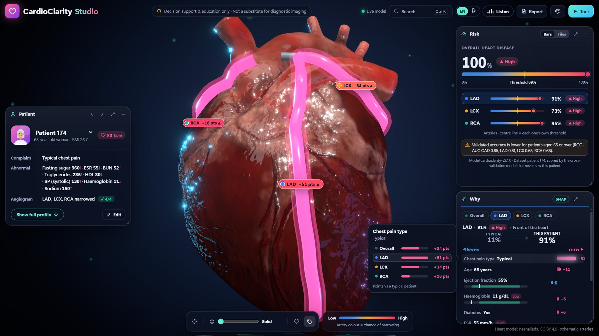</p>

<p align="center"><sub>Patient 174, a 68-year-old woman. Her angiogram found all three arteries narrowed, and CardioClarity got all four answers right. Pointing at "chest pain type" shows its effect on every artery, on the heart itself.</sub></p>

---

## ✨ What makes it stand out

### 1. Risk you can see, artery by artery

Each artery takes the **colour, thickness and glow of its own risk**: blue when low, amber at its alert level, red when high. Arteries above their alert level pulse with the heartbeat, which beats at the **patient's own pulse rate**. Click an artery and the camera flies to it; peel the heart from solid to **X-ray** to arteries only.

<table>
<tr>
<td width="42%">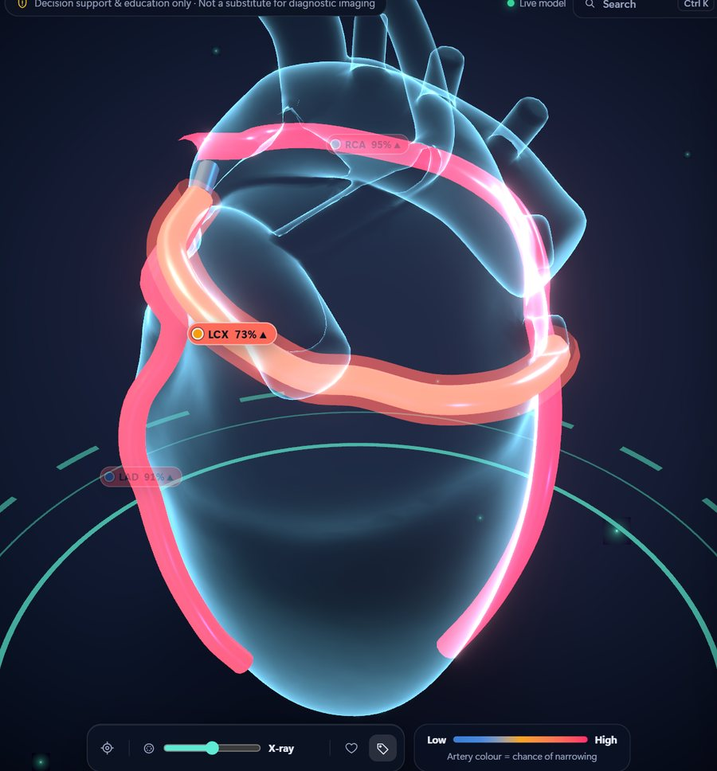</td>
<td>

- **Spatial risk mapping**: an artery's colour and its number are drawn from the same result and matched by artery name, not by position.
- **Smooth on ordinary laptops**: 56–59 frames per second on built-in Intel graphics, no graphics card (measured). If frames drop, it switches to a lighter setting by itself.
- **Accessible**: screen readers get a text summary of the heart, all motion can be switched off, and the whole app works from the keyboard.

</td>
</tr>
</table>

### 2. A reason behind every number (SHAP)

"Explain this prediction" shows how much **each test result raised or lowered** each risk, in percentage points, compared with a typical patient. The points **add up exactly** to the result: a typical patient's risk of 11% plus this patient's +80 points makes her 91%.

- 🫀 **On the heart**: point at any test and the artery labels show its effect on each artery.
- 📊 **Why panel**: each result with its value, normal range, a High/Low flag and its points, biggest first.
- 🗺️ **Factor map**: the strongest results across all four answers at once.

We compute SHAP on **the final percentage the app shows** (after calibration), so the explanation always matches the screen.

### 3. What if? In real time

Sliders for what a patient **can change**: weight, smoking, blood pressure, blood sugar and cholesterol. The models re-score, re-explain and recolour the heart in **about one second** on the live site (measured), with the original values marked.

<p align="center">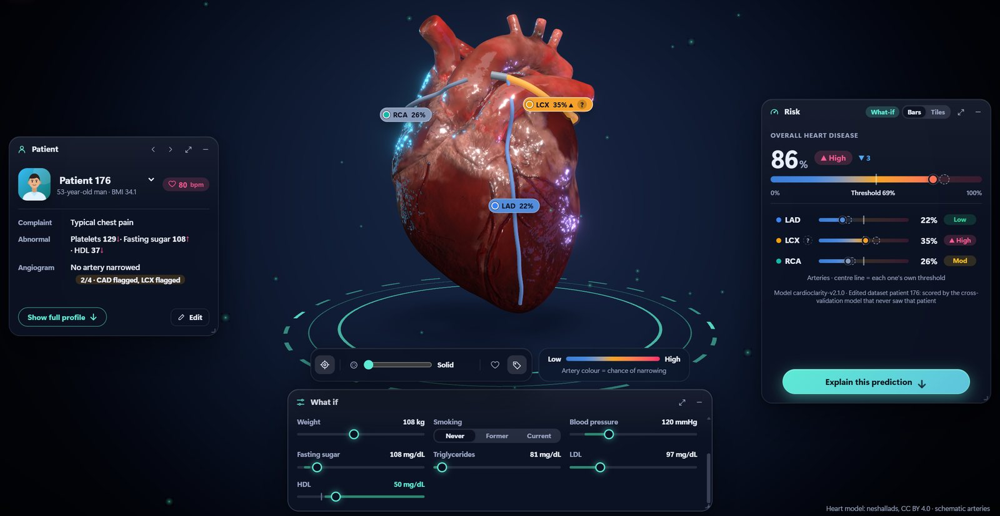</p>
<p align="center"><sub>Patient 176, a 53-year-old smoker. If he stopped smoking and his HDL ("good" cholesterol) rose from 37 to 50, his LCX risk would fall from 51% to 35%.</sub></p>

### 4. Explained in plain words, and in Hindi

<table>
<tr>
<td width="42%">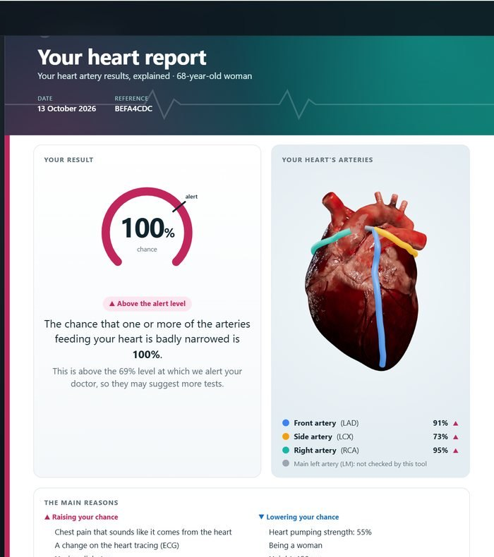</td>
<td>

**A report a patient can take home.** Three pages: the result with the 3D heart and the main reasons, each artery on its own, and their numbers against healthy ranges, questions for the doctor and **when to get help at once**. No jargon: the LAD is "the front artery", EF is "heart pumping strength".

**Listen.** One click reads a short summary aloud, with captions: the risk, which arteries, the four main reasons, any abnormal readings and the next step.

**सुनिए, हिंदी में.** Switch **EN | हिं** and the summary is spoken in **Hindi**, voiced by **Sarvam AI**. Medical terms stay in English, the way Indian doctors speak, so patients recognise them on their reports.

</td>
</tr>
</table>

<p align="center">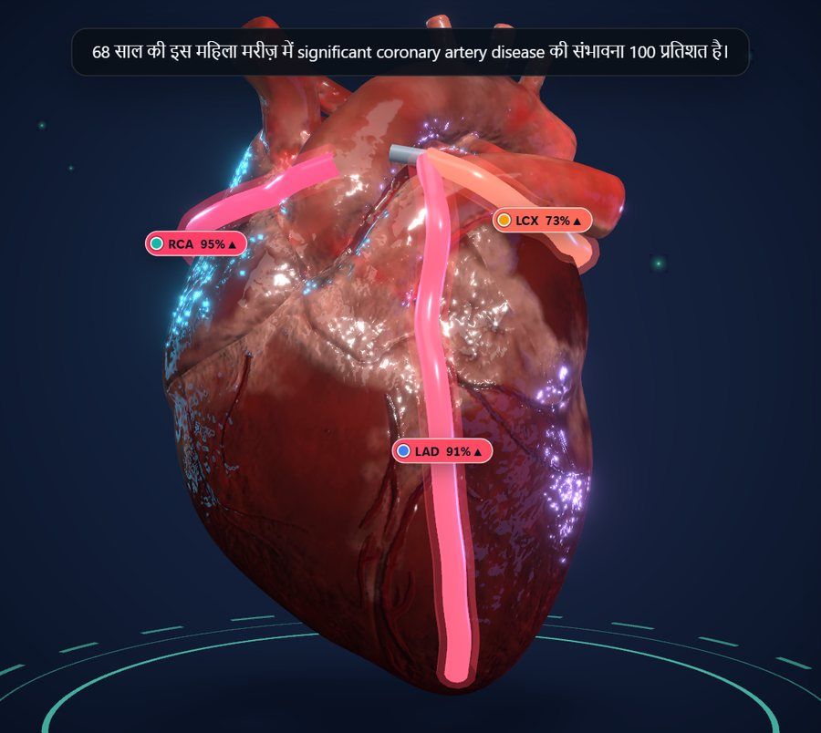</p>

> [!NOTE]
> Hindi is recorded for the four featured patients. We recorded each summary once (4 API calls, about ₹10 in total), so pressing Listen costs nothing and never waits on an AI service. Other patients hear the English summary.

### 5. Honest about what it doesn't know

- **Calibrated**: "70%" really means about 7 in 10 such patients have the disease.
- **"Unsure"** instead of a guess, when the model can't decide (a 90% conformal check).
- **No patient is scored by a model that has seen them**: five models per answer, each trained without one fifth of the patients.
- **Warnings** for groups where it is weaker, such as patients over 65.

### 6. Calm by design

Medical software often shows everything at once. We show **the answer first and details only when asked**: the heart is the screen, only two panels open at the start, and the patient summary lists only what is abnormal. Light and dark themes; **0 accessibility violations** in an automated axe scan.

---

## 🏥 Built for real Indian clinics

A good prediction saves no one if it takes ten minutes to type in, or if the patient can't read the answer. So we designed the whole path, from the patient's paperwork to their understanding.

<p align="center">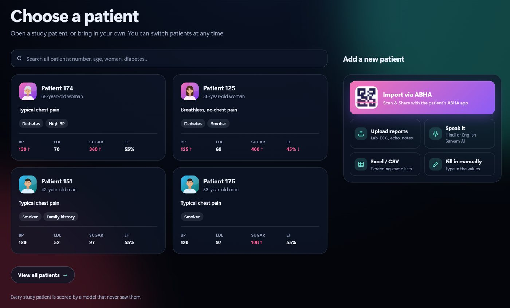</p>
<p align="center"><sub>The start screen: five ways to bring a patient in, most automatic first. Each one shows what it will do.</sub></p>

| Way in | What it does | Status |
|---|---|:-:|
| ✍️ **Fill in manually** | All 49 inputs with units, normal ranges and checks | ✅ **Live** |
| 🪪 **Import via ABHA** | The patient scans the clinic's QR code with their **ABHA** app and approves consent. Lab results, diagnoses and vitals arrive through the **Ayushman Bharat Digital Mission** in the standard FHIR format | 🧭 Designed |
| 📄 **Upload reports** | A photo, PDF or **WhatsApp forward** of the lab, ECG and echo reports, read by a **multimodal (vision) AI model** that shows where every value came from | 🧭 Designed |
| 🎙️ **Speak it** | Describe the patient in Hindi or English; **Sarvam AI** speech recognition fills the form | 🧭 Designed |
| 📊 **Excel / CSV** | For screening camps: score a whole list, **highest risk first**, so the right people are referred | 🧭 Designed |

**Why ABHA matters:** India has created **93.95 crore ABHA health IDs** (July 2026). With consent, a patient's records can arrive in seconds instead of being typed.

Every route ends on **one review screen**, so a person checks every value before anything is scored:

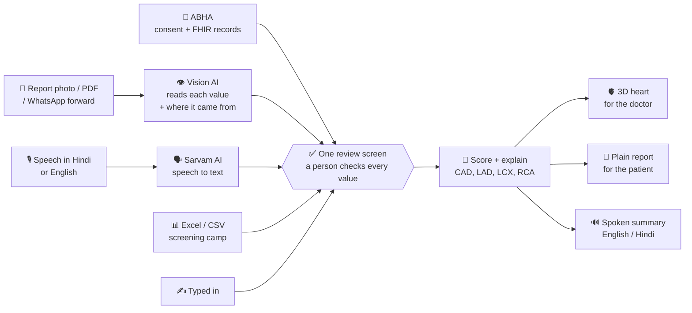

**Light enough for any clinic.** The models run on ordinary CPUs (no GPU server), the app runs on a laptop's built-in graphics, and the Hindi audio is pre-recorded, so a small clinic or a health camp needs nothing more than a browser.

---

## 🧠 Under the hood

### The models

303 patients from the public Z-Alizadeh Sani dataset, each confirmed by an **angiogram** (the X-ray test that shows narrowed arteries). We tried **more than 10 model types**, plus TabPFN and AutoGluon, and kept the best one for each answer.

| Answer | Model | ROC-AUC | 95% CI |
|---|---|:-:|:-:|
| **CAD** (any coronary artery disease) | Explainable Boosting Machine | **0.939** | 0.903–0.960 |
| **LAD** (front of the heart) | CatBoost | **0.869** | 0.822–0.906 |
| **LCX** (side and back) | XGBoost | **0.782** | 0.722–0.820 |
| **RCA** (right side and bottom) | Logistic stack of 8 models | **0.770** | 0.714–0.813 |

<sub>ROC-AUC: 1.0 is perfect, 0.5 is guessing. Scores of the served pipeline on held-out cross-validation repeats (r5–r9).</sub>

**How we kept ourselves honest:**
- **A sealed final test.** 10 × 5 repeated cross-validation. Half the repeats were used for every design choice; the other half stayed sealed until the final scores.
- **No peeking.** Input selection, scaling, calibration and alert levels were learned only from the training patients in each round.
- **Real gains only.** A change counted only if its improvement was statistically significant.
- **Answers kept out of the inputs.** The angiogram results are never used to predict.

Full results, calibration and subgroups: [`reports/BEST_MODELS.md`](reports/BEST_MODELS.md). Every experiment: [`ml/README.md`](ml/README.md).

### The system

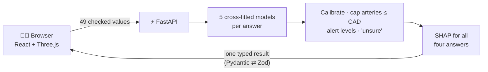

| Layer | Built with |
|---|---|
| **App** | React 18, TypeScript, Vite, React Three Fiber (Three.js / WebGL), zustand, TanStack Query, Zod |
| **API** | FastAPI, Pydantic, Python 3.11 |
| **ML** | scikit-learn, InterpretML (EBM), CatBoost, XGBoost, LightGBM, Optuna, TabPFN, pandas |
| **Voice** | Sarvam AI (Bulbul text-to-speech) |
| **Deploy** | One Docker image on Google Cloud Run, CPU only |
| **Quality** | 70 pytest + 163 Vitest tests, ESLint, axe accessibility checks, GitHub Actions |

---

<div align="center">

<a href="https://youtu.be/oskivSGjGLw"></a>
&nbsp;
<a href="https://cardioclarity-962866578386.us-central1.run.app"></a>
&nbsp;
<a href="docs/submission/DOCUMENTATION.pdf"></a>

</div>

---

## 🚀 Run it

**One container** (app and API together):

```bash
docker build -t cardioclarity .
docker run -p 8080:8080 cardioclarity     # open http://localhost:8080
```

**For development.** The API needs **Python 3.11** (the models are pickled with 3.11); the app needs Node.js 24.19+ and pnpm through Corepack.

```bash
pip install -r requirements.txt
uvicorn api.main:app --port 8000           # from the repository root

cd frontend
corepack enable
corepack pnpm install --frozen-lockfile
corepack pnpm dev                           # http://localhost:5173
```

**Rebuild the models** (CPU, about 3 minutes):

```bash
python scripts/download_data.py            # verifies SHA-256 checksums
python -m ml.export
```

**Re-record the Hindi audio:** put `SARVAM_API_KEY=...` in a `.env` file at the repository root (git-ignored), start the API, and run `node scripts/record-hindi.mjs` from `frontend/`.

**Deploy to Cloud Run:** `PROJECT=<your-project-id> scripts/deploy_cloudrun.sh` (Cloud Build builds the image; no local Docker needed).

<details>
<summary><b>📁 Repository layout</b></summary>

| Path | Contents |
|---|---|
| [`frontend/`](frontend) | React + TypeScript app with the 3D heart |
| [`api/`](api/README.md) | FastAPI service that scores and explains |
| [`models/`](models) | Exported cross-fitted models and their manifest |
| [`ml/`](ml/README.md) | Data preparation, feature engineering, model search and validation |
| [`reports/`](reports) | Experiment write-ups and result tables |
| [`data/`](data/README.md) | Source datasets (public, credited) |
| [`tests/`](tests) | Python tests for the pipeline and the API |
| [`scripts/`](scripts) | Data download, Cloud Run deploy, credits |
| [`docs/`](docs/submission) | Project documentation and README images |

</details>

---

## 🛣️ What's next

- 🇮🇳 **Test on Indian patients.** Our models learned from one hospital in Iran, and Indians get heart disease about ten years younger.
- 🪪 **ABHA import**, live, through the Ayushman Bharat Digital Mission.
- 📄 **Report reading** with a vision model, for photos, PDFs and WhatsApp forwards.
- 🗣️ **More Indian languages** (Bengali, Marathi, Tamil, Telugu and more) through Sarvam AI, for every patient, and **speaking instead of typing**.
- 🏕️ **Screening camps**: score a whole list at once and refer the highest risk first.

## ⚠️ Limitations

The models learned from 303 patients at one hospital and have not been tested on other hospitals' patients. They are weaker for patients over 65 and for the LCX and RCA arteries, and only slightly better than chance at telling *which* artery among patients who have disease, so the heart shows the chance an artery is involved, not where a blockage is. The 3D arteries are schematic, not the patient's own anatomy. SHAP points describe the model, not cause and effect.

## 🙏 Credits

- **Dataset:** Extension of Z-Alizadeh Sani, [UCI #411](https://archive.ics.uci.edu/dataset/411/extention+of+z+alizadeh+sani+dataset) (Alizadehsani, Roshanzamir and Sani, 2013; CC BY 4.0).
- **Heart model:** *Realistic Human Heart* by neshallads ([Sketchfab](https://sketchfab.com/3d-models/realistic-human-heart-3f8072336ce94d18b3d0d055a1ece089), CC BY 4.0). The arteries are drawn by us.
- **Hindi voice:** [Sarvam AI](https://www.sarvam.ai/).
- **EHR screenshot:** VistA CPRS, US Department of Veterans Affairs, public domain, via [Wikimedia Commons](https://commons.wikimedia.org/wiki/File:VistACPRScover.png).
- **Statistics:** GBD India (*Lancet Global Health* 2018); Prabhakaran et al. (*Circulation* 2016); *JSCAI* 2026; Irving et al. (*BMJ Open* 2017); Census of India 2011; ABDM (ABHA count, July 2026).

<div align="center">

**Team:** Ashish Mokalkar · Faizan Shaikh

Licensed under [Apache 2.0](LICENSE)

</div>
