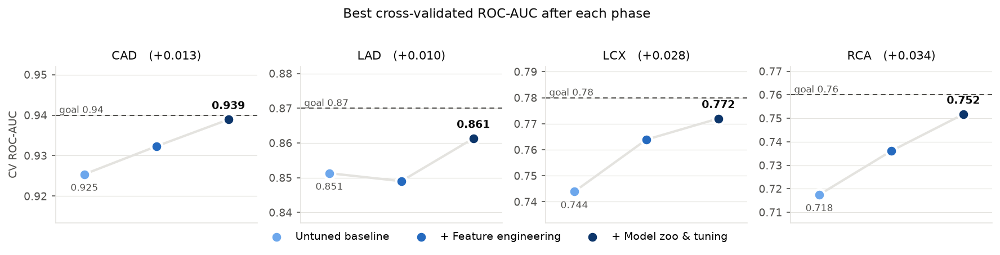
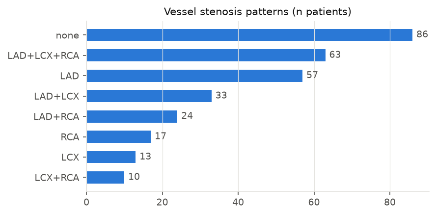
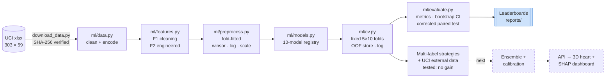
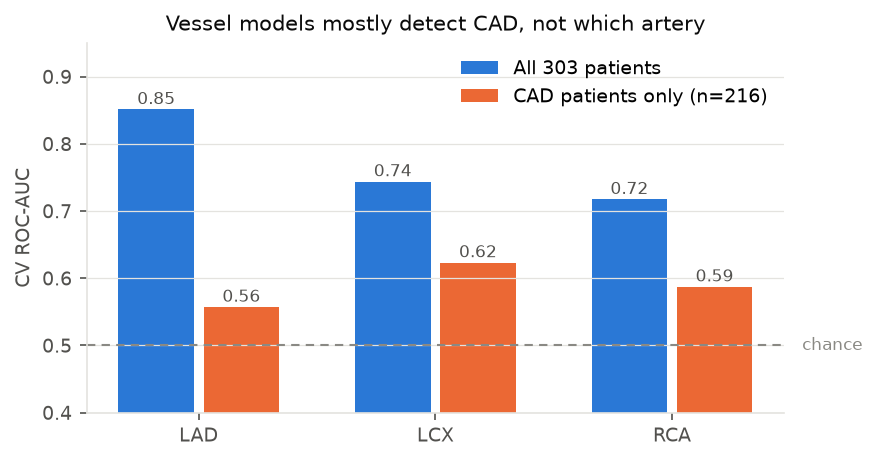
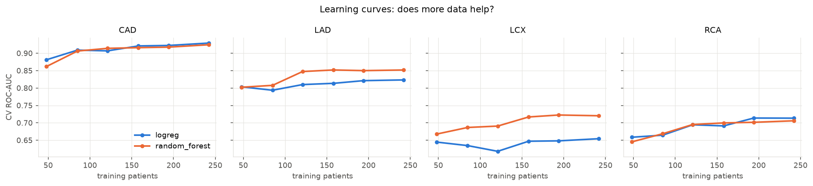
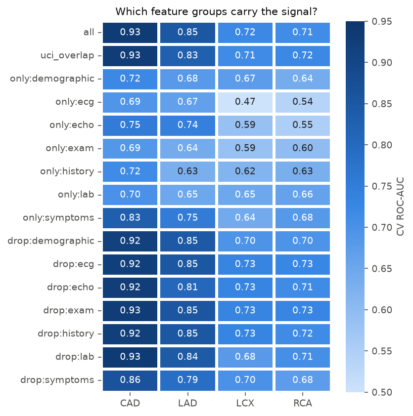
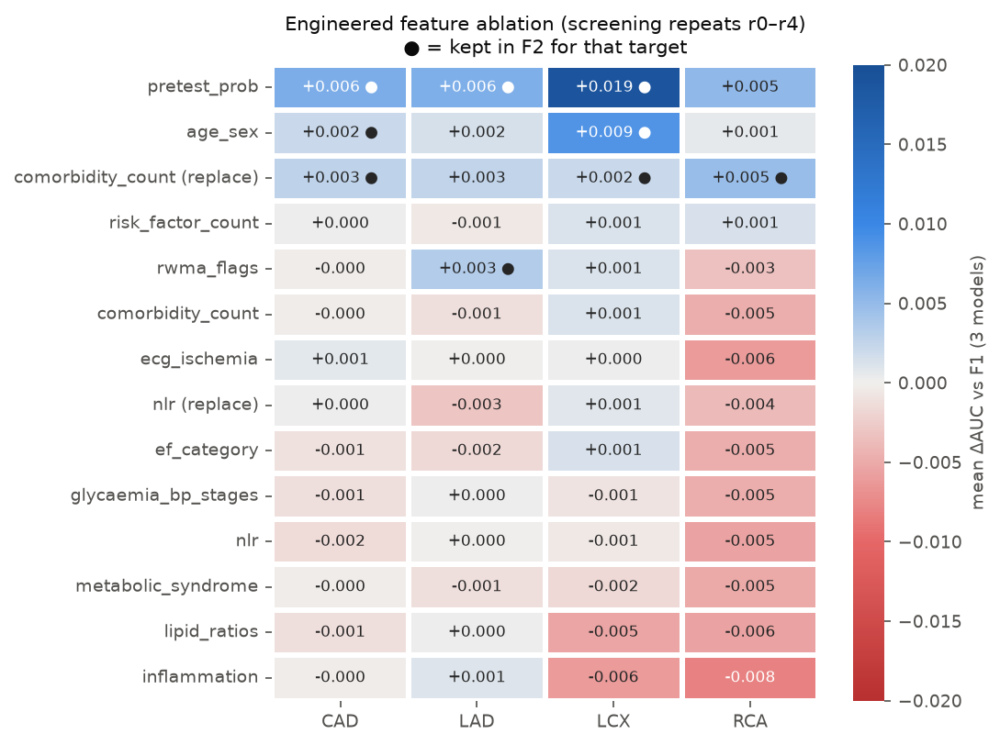
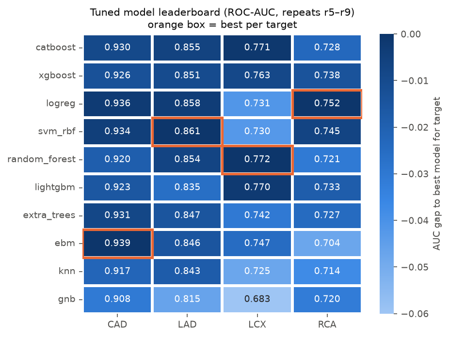

<div align="center">

# 🫀 CardioTwin

### Predicting coronary artery disease, and *which artery*, from routine clinical data

**Multimodal AI Hackathon 2026 · Track A: Cardiovascular Risk Visualization & Prediction**


[Competition page](https://multimodal-ai-hackathon-2026-7.devpost.com/) · [Plan](plan.md) · [EDA report](reports/EDA.md) · [Feature report](reports/PHASE2_FEATURES.md) · [Model report](reports/PHASE3_MODELS.md)

</div>

> [!WARNING]
> **Clinical safety disclaimer.** This project is for **decision support and educational purposes only**. Its predictions are
> not a diagnosis and are **not a substitute for coronary angiography or other formal diagnostic imaging**.

---

## ✨ Results so far

<div align="center">

</div>

| Target | What it means | Best model | ROC-AUC | 95% CI | Accuracy* | Untuned baseline | Goal |
|---|---|---|:---:|:---:|:---:|:---:|:---:|
| **CAD** | any coronary artery ≥ 50% narrowed | EBM (glassbox GAM) | **0.939** | 0.908–0.962 | 0.884 | 0.925 | 0.94 |
| **LAD** | left anterior descending stenosis | SVM-RBF | **0.861** | 0.815–0.902 | 0.800 | 0.851 | 0.87 |
| **LCX** | left circumflex stenosis | Random forest (5-seed bag) | **0.772** | 0.717–0.818 | 0.689 | 0.744 | 0.78 |
| **RCA** | right coronary artery stenosis | Elastic-net logistic regression | **0.752** | 0.694–0.802 | 0.698 | 0.718 | 0.76 |

<sub>All scores are repeated stratified 5-fold CV on folds the tuning never saw (repeats r5–r9). CIs are a 1,000× patient bootstrap.
\*Accuracy at a 0.5 threshold; per-target threshold tuning comes in phase 8. The baseline used the EDA's own folds, so the stage-to-stage
steps in the chart are indicative, not paired.</sub>

---

## 📑 Contents
1. [The challenge in one minute](#-the-challenge-in-one-minute)
2. [Dataset](#-dataset)
3. [Pipeline](#-pipeline)
4. [Key insights from the EDA](#-key-insights-from-the-eda)
5. [Validation: how we keep the numbers honest](#-validation-how-we-keep-the-numbers-honest)
6. [Feature engineering](#-feature-engineering)
7. [Model zoo and tuning](#-model-zoo-and-tuning)
8. [Bugs we caught](#-bugs-we-caught)
9. [Roadmap](#-roadmap)
10. [Quickstart](#-quickstart)
11. [Repository layout](#-repository-layout)

---

## ⏱ The challenge in one minute

Given **~55 routine measurements** (demographics, vitals, labs, ECG and echo findings), predict:

| Output | Ground truth from catheterisation |
|---|---|
| Overall **CAD** | ≥ 50% narrowing in any major coronary artery |
| **LAD** stenosis | front of the heart |
| **LCX** stenosis | side and back of the heart |
| **RCA** stenosis | right side and bottom of the heart |

The predictions then drive an **interactive 3D heart** whose arteries are coloured by risk, alongside a **SHAP explanation dashboard**.
Judging weights: predictive performance **30%**, 3D visualisation **25%**, interpretability **20%**, integration **15%**, engineering **10%**.

---

## 🗂 Dataset

**[Extension of Z-Alizadeh Sani](https://archive.ics.uci.edu/dataset/411/extention+of+z+alizadeh+sani+dataset)** (UCI #411): 303 patients from Iran, with no missing values.

<table>
<tr>
<td width="50%">

| | |
|---|---|
| Patients | **303** |
| Features | **55** (21 continuous · 3 ordinal · 31 binary) |
| Feature groups | demographic · history · exam · symptoms · ECG · lab · echo |
| Targets | CAD, LAD, LCX, RCA |
| Leakage guard | LAD/LCX/RCA/Cath are **never** inputs |

| Target | Positive | Prevalence |
|---|:---:|:---:|
| CAD | 216 | 71.3% |
| LAD | 177 | 58.4% |
| LCX | 119 | 39.3% |
| RCA | 114 | 37.6% |

</td>
<td width="50%">



**Multi-vessel disease is common:** 63 patients have all three arteries narrowed. CAD is equivalent to "any vessel stenotic", with 1 exception.

</td>
</tr>
</table>

---

## 🧭 Pipeline



---

## 🔍 Key insights from the EDA

Full report: **[reports/EDA.md](reports/EDA.md)**

### 1 · Vessel models mostly detect *whether* there is CAD, not *where*

<table>
<tr>
<td width="55%"></td>
<td>

Scored only on CAD patients, vessel AUC drops close to chance.
Separating healthy from diseased is the easy part; **localisation is the hard part**.

➡️ Phase 4 tested hierarchical `P(CAD) × P(vessel | CAD)` and label stacking: **no significant AUC gain**, but better calibration
and guaranteed consistency (P(vessel) ≤ P(CAD)). Localisation needs *new data*, hence phase 5.
The 3D view will show vessel risk as *relative likelihood*, not as a lesion location.

</td>
</tr>
</table>

### 2 · More data would help LCX and RCA, but not CAD



CAD and LAD flatten out; LCX and RCA are **still rising** at 242 training patients. Phase 5 therefore harmonised **605 extra vessel-labelled patients**
from the raw UCI Heart Disease files (Cleveland, VA Long Beach, Switzerland). **It did not help.** A UCI-trained model reaches only 0.63–0.71 AUC on our cohort,
and chest-pain semantics are *reversed* between the datasets (UCI "asymptomatic" patients have the highest CAD rate). More data helps only if it is *like* ours.
See [PHASE5_EXTERNAL.md](reports/PHASE5_EXTERNAL.md).

### 3 · Where the signal lives

<table>
<tr>
<td width="45%"></td>
<td>

| Finding | Evidence |
|---|---|
| **Chest pain type + age** dominate | univariate AUC 0.80 / 0.72 for CAD |
| **Echo matters for LAD** | dropping echo: 0.85 → 0.81 |
| **ECG alone is useless for LCX** | AUC 0.47 (the "silent" circumflex) |
| **Any RWMA ≥ 3 → LAD stenosis** | 28 / 28 patients |
| **UCI-overlap features keep almost all signal** | CAD 0.93, RCA 0.72 with only 17 shared features |
| **File is sorted by label** | CAD prevalence 80% → 33% down the rows; always shuffle |
| **Heavy redundancy** | BMI = f(weight, height) exactly; obesity = BMI ≥ 25 |

</td>
</tr>
</table>

---

## 🛡 Validation: how we keep the numbers honest

Predictive performance is judged on *validation methodology*, so the numbers have to be trustworthy.

| Safeguard | How |
|---|---|
| **No target leakage** | LAD/LCX/RCA/Cath are never features (enforced by tests); features are invariant to label shuffling (tested) |
| **One fixed fold file** | 5-fold × 10 repeats, stratified on the joint CAD+vessel pattern; every experiment is paired on identical folds |
| **Everything fitted in-fold** | winsorising, scaling, tuning and calibration are fitted on the training fold only |
| **Separate folds per decision** | features are *screened* on r0–r4, models are *tuned* on r0–r2, and every reported number uses the untouched **r5–r9** |
| **Honest significance** | the keep/drop rule uses the **Nadeau–Bengio corrected SE** (repeated-CV folds overlap, so the naive SE is ~3.7× too optimistic) |
| **Uncertainty** | 95% patient-bootstrap CIs for every metric |
| **Stability check** | each leaderboard flags models whose pooled AUC drifts > 0.03 from their fold-mean AUC |

| Repeats → | r0 | r1 | r2 | r3 | r4 | r5 · r6 · r7 · r8 · r9 |
|---|:---:|:---:|:---:|:---:|:---:|:---:|
| Feature screening (P2) | 🟦 | 🟦 | 🟦 | 🟦 | 🟦 | |
| Hyperparameter tuning (P3) | 🟧 | 🟧 | 🟧 | | | |
| **Reported scores** | | | | | | ✅ **evaluation only** |

---

## 🧪 Feature engineering

Report: **[reports/PHASE2_FEATURES.md](reports/PHASE2_FEATURES.md)**. Twelve clinically motivated candidates were each added to the cleaned set and kept per target only if they passed the corrected-SE rule.

<table>
<tr>
<td width="55%"></td>
<td>

**Winners**
- 🥇 **`pretest_prob`**: the Diamond-Forrester pre-test probability table (age × sex × chest-pain type). Univariate AUC **0.83** for CAD, stronger than any raw feature; **+0.019** for LCX.
- **`comorbidity_count`** replaces 8 near-empty binaries (CHF has 1 positive) and helps 3 of 4 targets.
- **`age_sex`** interactions help CAD and LCX; **RWMA flags** help LAD.

**Didn't help:** NLR, lipid ratios, PLR, metabolic score, ECG pooling. Several *hurt* LCX/RCA, so they were dropped.

**Gain, F0 → F2** (best model, untouched repeats):
CAD +0.008 · LAD +0.007 · LCX **+0.023** · RCA **+0.022**

</td>
</tr>
</table>

---

## 🤖 Model zoo and tuning

Report: **[reports/PHASE3_MODELS.md](reports/PHASE3_MODELS.md)**. Ten model families, each with Optuna TPE tuning (12–60 trials) on r0–r2 and scoring on r5–r9.

<table>
<tr>
<td width="55%"></td>
<td>

| Family | Models |
|---|---|
| Linear / kernel | elastic-net LR, SVM-RBF, kNN, Gaussian NB |
| Bagged trees | Random forest, ExtraTrees |
| Gradient boosting | XGBoost, LightGBM, CatBoost |
| Glassbox | **EBM** (InterpretML) |
| Optional | TabPFN (needs licence acceptance) |

**Takeaways**
- **No single winner.** The top 3–5 models per target are within ~0.01 AUC, so ensembling is the next lever.
- **CAD and RCA prefer smooth models**; **LCX prefers trees** (interactions).
- Tuning helps most on the vessels: up to **+0.048** (XGBoost on RCA).
- **EBM wins CAD** and is fully interpretable, which suits the explanation dashboard.

</td>
</tr>
</table>

---

## 🐛 Bugs we caught

Rigorous checks surfaced real problems before they reached the results:

| Problem | How we noticed | Fix |
|---|---|---|
| Ordinal chest-pain code cost LR **−0.010 AUC** | F0 → F1 ablation went negative | one-hot categoricals for linear models only |
| CatBoost crashed the CV harness | runner treated non-sklearn estimators as callables | duck-typed `fit`/`predict_proba` detection plus a regression test; per-model result cache so runs resume |
| SVM looked like **0.862** AUC but pooled at **0.759** | bootstrap CI didn't contain the point estimate | a single Platt fit collapsed in one fold, so we average 5 calibrations; stability flag added to every leaderboard |
| Naive paired SE **3.7× too small** | repeated-CV folds share patients | Nadeau–Bengio corrected variance in `paired_compare` |
| Bootstrap CIs took 107 s per model | profiling | vectorised numpy metrics, now **0.5 s** for 1,000 resamples |

---

## 🗺 Roadmap

| Phase | Status | Focus |
|---|:---:|---|
| EDA | ✅ | data quirks, signal map, learning curves, headroom |
| P1 · Validation harness | ✅ | fixed folds, OOF store, metrics, CIs, corrected tests |
| P2 · Feature engineering | ✅ | F1 cleaning, 12 candidates, per-target F2 |
| P3 · Model zoo + tuning | ✅ | 10 families, Optuna, seed bagging, leaderboards |
| P4 · Multi-label strategy | ✅ | hierarchical `P(CAD)·P(v\|CAD)` and stacking: no significant AUC gain, better calibration ([report](reports/PHASE4_STRATEGIES.md)) |
| P5 · External data | ✅ | 605 UCI vessel-labelled patients harmonised; **no gain** due to cohort shift ([report](reports/PHASE5_EXTERNAL.md)) |
| P6 · Feature selection | ⏳ | per-target, inside CV |
| P7 · Ensembling | 🔜 | hill-climbing / stacking with nested CV |
| P8 · Calibration + thresholds | 🔜 | Platt/beta, per-target thresholds, conformal uncertainty |
| P9 · Export | 🔜 | `models/*.joblib`, `metrics.json` for the 3D dashboard |

Detailed plan: **[plan.md](plan.md)**

---

## 🚀 Quickstart

```bash
python -m venv .venv
.venv\Scripts\activate                      # macOS/Linux: source .venv/bin/activate
pip install -r requirements.txt

python scripts/download_data.py             # fetch + checksum the UCI dataset
pytest -q                                   # 46 tests

python -m ml.eda                            # EDA tables + figures      (~12 min)
python -m ml.run_baselines                  # P1 baselines              (~1 min)
python -m ml.run_features                   # P2 feature ablation       (~15 min)
python -m ml.run_models --target lcx        # P3 zoo + tuning, per target (~20 min)
python -m ml.run_strategies                 # P4 multi-label strategies (~10 min)
python -m ml.run_external                   # P5 UCI external data      (~25 min)
python -m ml.report_figures                 # README figures            (seconds)
```

Every scored run is appended to [`reports/experiments.csv`](reports/experiments.csv) with its git hash.

---

## 📁 Repository layout

```
├── data/
│   ├── raw/z_alizadeh_sani_ext/      # original xlsx (committed, checksummed)
│   ├── raw/uci_heart_disease/        # raw 76-attribute UCI files (external data)
│   └── processed/                    # folds.csv, OOF predictions (regenerated, git-ignored)
├── ml/
│   ├── data.py          # load + encode, feature groups, targets
│   ├── features.py      # F1 cleaning + engineered features (pre-test probability, …)
│   ├── preprocess.py    # fold-fitted linear preprocessing
│   ├── models.py        # model registry, search spaces, seed bagging
│   ├── strategies.py    # hierarchical, stacked and pooled (external data) strategies
│   ├── external.py      # UCI Heart Disease raw-file parser + harmonisation
│   ├── cv.py            # fixed folds, CV runner, OOF store, experiment log
│   ├── evaluate.py      # metrics, bootstrap CIs, calibration, corrected paired test
│   ├── eda.py · run_baselines.py · run_features.py · run_models.py · run_strategies.py · run_external.py · report_figures.py
│   └── viz.py           # shared chart style
├── reports/             # EDA.md, PHASE2–5 reports, tables, figures, leaderboards
├── scripts/download_data.py
├── tests/               # leakage, folds, metrics, features, models
└── plan.md
```

---

<div align="center">

**Data:** Alizadehsani R., Roshanzamir M., Sani Z. *Extension of Z-Alizadeh Sani dataset*, UCI Machine Learning Repository.
**Pre-test probability:** Diamond G.A., Forrester J.S., NEJM 1979.

<sub>⚠️ For research and education only. Not a medical device.</sub>

</div>
