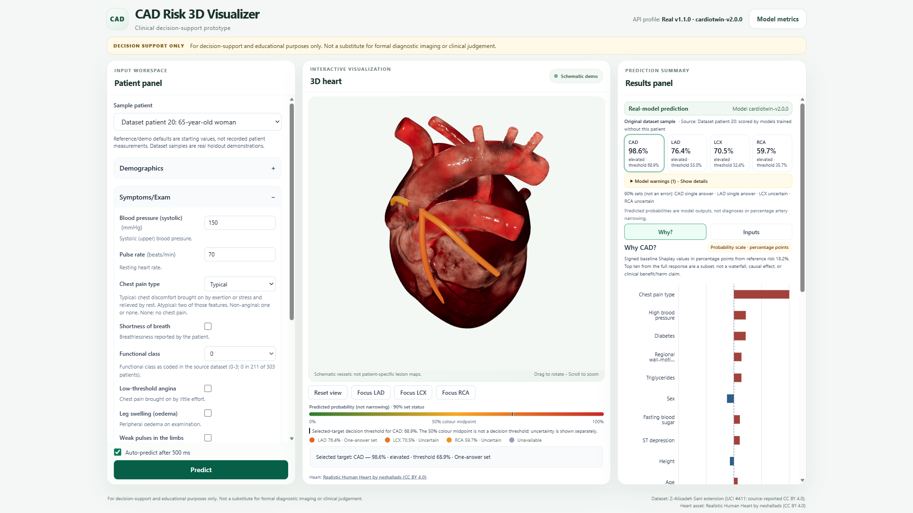

# CardioTwin: Interactive Coronary Risk Exploration

**Project-document draft | 10 October 2026 | source freeze:** `39ffab1c8adecd707c0f40ce826c12a568c41267`

> **Review status:** Draft only. Ashish must verify the dataset/preprocessing, model, validation, subgroup and demo-model statements before finalisation. This is a local prototype, not a deployed or clinically validated system.

## 1. Problem and system

Cardiovascular risk models can return numbers that are difficult to relate to the anatomy and measurements behind them. CardioTwin is a browser-based decision-support and educational prototype for exploring predicted coronary artery disease (CAD) and vessel-level results alongside structured clinical, ECG, laboratory and echocardiographic inputs.

The user selects one of eight real dataset demonstration patients or supplies a complete input profile. The browser calls a local FastAPI service and presents the response's CAD, LAD, LCX and RCA probabilities, thresholds, uncertainty, cautions and fitting-set provenance. Users can rotate and zoom a 3D heart, select a vessel, and inspect model contributions and input details. For paired what-if exploration, editing a dataset sample retains its sample ID; the UI clears stale results while a fresh response is pending.



*Illustration source: `docs/evidence/s4p2-patient20-cad-why-1920x1080.png`. Returned outputs are examples, not diagnoses or narrowing measurements.*

<!-- pagebreak -->

## 2. Dataset, inputs and preprocessing

The pinned real profile uses the Extension of the Z-Alizadeh Sani dataset (UCI Machine Learning Repository #411), with 303 patient records. The binary targets are overall CAD and stenosis labels for the LAD, LCX and RCA. The service exposes 49 required, named inputs across demographics, history, examination, symptoms, ECG, laboratory tests and echocardiography. It requires a complete supported schema; this is not a missing-data imputation workflow.

The checked-in loader maps raw sex, yes/no, valve-disease and bundle-branch-block categories to numeric codes; maps the four labels; and rejects unmapped values or missing values rather than silently filling them. `Exertional CP` is dropped because it is constant in this dataset. Feature construction includes candidate clinical scores, ratios, counts and interactions; the selected inputs differ by target. Data-dependent transformations and feature selection are fitted within training folds. The API and model inputs exclude **LAD, LCX, RCA and Cath** as predictors; they are labels only, preventing target leakage.

Eight non-synthetic sample patients are served with ground truth for demonstration. The pinned demo estimators were refitted without those eight rows; the final estimators use all 303 rows. A sample ID is retained across edits to keep a paired what-if request on the demo-model path. Ground truth describes the original sample, not an edited profile. Requests without a sample ID use the final models. The response reports the actual source; the frontend does not infer or recompute it.

<!-- pagebreak -->

## 3. Models and evaluation

The pinned model version is `cardiotwin-v2.0.0`. The four targets use independently selected estimators: Explainable Boosting Machine (CAD), CatBoost (LAD), XGBoost (LCX), and an eight-estimator logistic stack (RCA). Probabilities are calibrated; thresholds are target-specific. The real service caps each served vessel probability at the served CAD probability. Equal values alone do not prove that this cap changed a result.

The report uses ten repeats of five-fold stratified cross-validation on fixed folds. Decisions were made using repeats 0–4 and the table reports ROC-AUC on repeats 5–9; the CAD champion carries a small earlier selection effect, and the report notes mild optimism in ensemble comparisons. Thresholds and calibration were fitted inside outer training folds. Values below are cross-validation estimates, not clinical validation or independently validated metrics for the demo refits.

| Target | Model | ROC-AUC (95% CI) | Accuracy | Precision | Recall | F1 |
|---|---|---:|---:|---:|---:|---:|
| CAD | EBM | 0.939 (0.908-0.962) | 0.867 | 0.944 | 0.867 | 0.903 |
| LAD | CatBoost | 0.866 (0.824-0.905) | 0.781 | 0.811 | 0.820 | 0.813 |
| LCX | XGBoost | 0.784 (0.727-0.824) | 0.683 | 0.577 | 0.746 | 0.646 |
| RCA | 8-model logistic stack | 0.767 (0.715-0.811) | 0.669 | 0.546 | 0.736 | 0.625 |

The cohort is small and comes from one dataset. Performance is weaker for some subgroups, notably older patients in the reported analysis. These results do not establish generalisation to other hospitals or populations, prospective benefit, or clinical safety.

<!-- pagebreak -->

## 4. 3D pipeline and explanation dashboard

The frontend uses React, TypeScript, Three.js and React Three Fiber. The licensed heart is a single mesh; it does not contain separately segmented coronary arteries. LAD, LCX and RCA are project-authored schematic tube paths overlaid on the heart. They are not patient-specific vessels or lesion locations. Orbit and zoom controls support inspection, and selection presents the matching returned target.

The vessel palette represents absolute 0–100% predicted probability. The returned decision threshold is a separate marker; it is not the 50% colour midpoint. Neither probability nor threshold is a percentage of anatomical narrowing. The UI retains response provenance, uncertainty and warnings alongside all four predictions.

The **Why?** view displays signed contributions on the served probability scale. A contribution of `+0.12` means +12 probability points relative to the response's reference patient; it does not mean a relative 12% change, causal benefit or treatment effect. The visible top-ten chart is a subset, not a complete additive waterfall. The **Inputs** view keeps accepted values, units, groups and returned derived values available for inspection.

**Request path:** React dashboard -> supported `/features`, `/patients/samples`, `/predict` and `/model/metrics` endpoints -> pinned FastAPI real profile -> manifest-selected model artifacts. Contract `1.1.0` and response provenance are shown in the UI. The application presents returned predictions without recomputing them.

<!-- pagebreak -->

## 5. Reproduction, safety and attribution

**Frontend (Node 24.19.0 tested; pnpm 12.9.1 pinned).** From a repository checkout:

```bash
cd frontend
corepack enable
corepack prepare pnpm@12.9.1 --activate
corepack pnpm install --frozen-lockfile
corepack pnpm dev
```

For the real API, the tested runtime is Ubuntu 24.04.5 on WSL 2 with Python 3.11.9 and uv 0.12.24. From the repository root in Ubuntu, prepare the pinned environment once, then run the service:

```bash
export PATH="$HOME/.local/bin:$PATH"
uv python install 3.11.9
VENV="$HOME/.venvs/multimodal-ai-hack-real-api"
if [ ! -x "$VENV/bin/python" ]; then uv venv --python 3.11.9 "$VENV"; fi
uv pip install --python "$VENV/bin/python" -r requirements.txt
"$VENV/bin/uvicorn" api.main:app --host 127.0.0.1 --port 8000
```

The existing manifest, model files, dataset workbook and subgroup report are runtime inputs; starting the service does not train or export models. See the root README for readiness checks, frontend commands, mock profile and the Windows/WSL split. This documents the tested environment, not a fresh-machine installation or public deployment.

**Safety and limitations.** The application states: *“For decision-support and educational purposes only. Not a substitute for formal diagnostic imaging or clinical judgement.”* Its outputs are predictions, not diagnoses, narrowing percentages, lesion maps or treatment advice. Thresholds are independent per target; uncertainty and returned warnings qualify results. Contributions describe model attribution, not causal effects. Cross-validation on this cohort is not external or clinical validation.

**Attribution.** Dataset: Extension of the Z-Alizadeh Sani dataset, UCI #411; Alizadehsani, Roshanzamir and Sani (2013). The repository records CC BY 4.0 attribution; retain the dataset citation and licence notice. Model software: EBM (MIT), CatBoost and XGBoost (Apache-2.0), scikit-learn (BSD), and LightGBM (MIT), as listed in `reports/BEST_MODELS.md`. Heart mesh: *Realistic Human Heart*, neshallads, Sketchfab, CC BY 4.0; the project copy is renamed `heart.glb` and is not modified. Coronary overlays are project-authored schematic geometry.

**References:** Track A brief (`docs/problem_statement.md`); API and profile (`docs/api-contract.md`); model manifest (`models/manifest.json`); validation and model-selection report (`reports/BEST_MODELS.md`); ML integration handover (`handover_docs/ML_ANSWERS_FOR_FRONTEND.md`); setup (`README.md`); heart source and licence (`assets/heart/LICENSE.md`); [UCI dataset #411](https://archive.ics.uci.edu/dataset/411/extension+of+z-alizadeh+sani+dataset); [CC BY 4.0](https://creativecommons.org/licenses/by/4.0/); [Sketchfab heart source](https://sketchfab.com/3d-models/realistic-human-heart-3f8072336ce94d18b3d0d055a1ece089).
